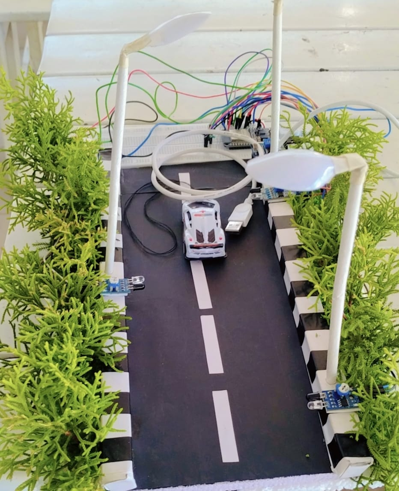

# Smart Street Light Using ESP32

An IoT-based smart street lighting system designed to improve energy efficiency through automatic lighting control and motion detection.

## 📌 About the Project

This project uses an ESP32 microcontroller, an LDR sensor, and three IR sensors to automate street lighting based on ambient light conditions and movement detection.

During darkness, the system checks each IR sensor and controls its corresponding LED. During daylight, all three LEDs remain switched off.

## 🎯 Objectives

- Automate street lighting based on ambient light.
- Detect movement using IR sensors.
- Control individual street lights according to sensor inputs.
- Explore energy-efficient solutions using embedded systems and IoT.

## 🛠️ Components Used

- ESP32 NodeMCU
- 1 LDR sensor
- 3 IR sensors
- 3 LEDs
- Connecting wires
- Breadboard

## 🔌 Hardware Connections

| Component | ESP32 GPIO |
|-----------|------------|
| LDR Sensor | 21 |
| IR Sensor 1 | 15 |
| IR Sensor 2 | 23 |
| IR Sensor 3 | 4 |
| LED 1 | 5 |
| LED 2 | 19 |
| LED 3 | 22 |

## ⚙️ Working Principle

1. The LDR sensor detects the surrounding light condition.
2. During daylight, all LEDs remain OFF.
3. During darkness, the ESP32 reads the three IR sensor inputs.
4. Each IR sensor controls its corresponding LED.
5. When an IR sensor detects an object (logic LOW), its corresponding LED turns ON.
6. The system continuously checks the sensor inputs at 0.5-second intervals.

## 💻 Software and Technologies

- MicroPython
- ESP32
- Embedded Systems
- IoT
- Sensor-based Automation

## 📂 Source Code

The project source code is written in MicroPython and is intended to run on the ESP32 board.

The source code is included in this repository.

## 🏆 Project Outcome

The prototype demonstrates automatic street lighting using ambient-light sensing and individual motion detection, providing a practical example of sensor-based automation.

## 👥 Team

Developed as a collaborative academic project.

## 🚀 Future Scope

- Integration of real-time energy monitoring.
- Solar-powered street lighting.
- Remote monitoring and control.
- Improved lighting efficiency using advanced sensors.

---

**Academic Project | Smart Street Lighting | ESP32 and IoT**

## Project Demonstration

